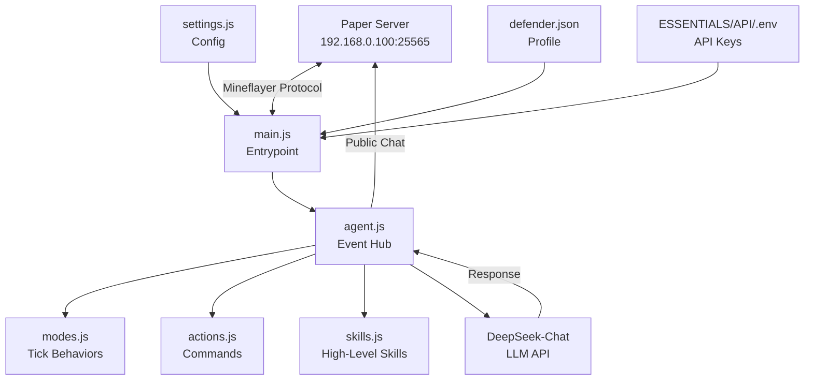
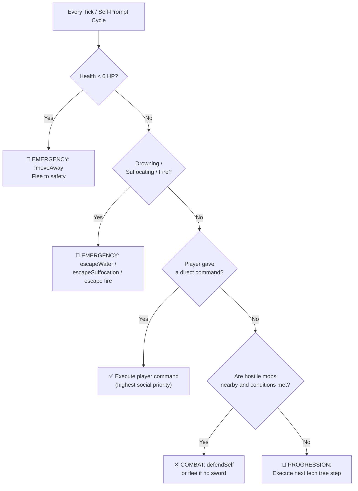

# Minecraft Server & Mindcraft AI (`Defender_AI`) Project Documentation

> [!NOTE]
> **Stack**: Paper Minecraft 1.20.4 · Mindcraft (Mineflayer + mineflayer-pathfinder + mineflayer-pvp) · DeepSeek-Chat LLM · Node.js  
> **Bot**: `Defender_AI` · **Server**: `192.168.0.100:25565` · **Auth**: `offline` (LAN/private only)  
> **Last Updated**: November 2026

---

## Table of Contents

1. [Project Overview & Architecture](#1-project-overview--architecture)
2. [Project Objectives](#2-project-objectives)
3. [Configuration & Connection](#3-configuration--connection-settingsjs)
4. [Defender_AI Profile](#4-defender_ai-profile-profilesdefenderjson)
5. [Features](#5-features)
6. [Security](#6-security)
7. [Goals & Tasks (Autonomous Behavior)](#7-goals--tasks-autonomous-behavior)
8. [Command Reference](#8-command-reference)
9. [How to Run and Maintain](#9-how-to-run-and-maintain)

---

## 1. Project Overview & Architecture

This repository contains the setup, configuration, and custom autonomous AI integration for a **Paper Minecraft (1.20.4) multiplayer server**.

The artificial intelligence agent, named **`Defender_AI`**, acts as an autonomous, player-like companion and server guardian. Built on the [Mindcraft](file:///c:/Users/HP/Documents/PRACTICE_PROG/SERVER/MCSERVERPROJ/AIPROJ/mindcraft) Mineflayer framework powered by Large Language Models (DeepSeek-Chat), the agent features custom survival reflexes, building systems, combat logic, and friendly social behaviors.

### Directory Structure

```
c:\Users\HP\Documents\PRACTICE_PROG\SERVER\
│
└── MCSERVERPROJ/
    ├── AIPROJ/
    │   └── mindcraft/             # Core autonomous AI bot codebase (Mineflayer + LLM)
    │       ├── profiles/
    │       │   └── defender.json  # Defender_AI profile, directives, and mode toggles
    │       ├── src/
    │       │   ├── agent/
    │       │   │   ├── agent.js             # Event handling, chat parsing, greetings, self-prompter
    │       │   │   ├── modes.js             # Autonomous tick behaviors (survival, combat, unstuck, social)
    │       │   │   ├── commands/
    │       │   │   │   ├── actions.js       # Action registry (!buildShelter, !fillArea, !stay, etc.)
    │       │   │   │   └── index.js         # Command parser, validation, and documentation
    │       │   │   └── library/
    │       │   │       ├── skills.js        # High-level bot skills (building, eating, combat, navigation)
    │       │   │       └── world.js         # World block and entity queries
    │       │   ├── mindcraft/
    │       │   │   └── mcserver.js          # Server proxy & version translation hooks
    │       │   └── utils/
    │       │       └── mcdata.js            # Minecraft data helpers & mappings
    │       ├── settings.js                  # Mindcraft connection & behavior configuration
    │       ├── package.json                 # Node dependencies
    │       └── main.js                      # Application entrypoint
    │
    ├── ESSENTIALS/
    │   ├── API/
    │   │   └── .env                         # Environment variables and API keys (never committed)
    │   └── SKINS/                           # Bot skin resources and textures
    │
    └── MCADDONS/                            # Server plugins, datapacks, and addon storage
```

### System Architecture Diagram



---

## 2. Project Objectives

> [!IMPORTANT]
> These are the **core goals** driving every design decision in this project.

### Primary Objectives

| # | Objective | Description |
|---|-----------|-------------|
| 1 | **Lifelike AI Companion** | Create a bot that behaves indistinguishably from a real, skilled Minecraft player — gathering resources, crafting, building, surviving, and socializing naturally without manual input. |
| 2 | **Autonomous Survival Progression** | The bot independently progresses through Minecraft's tech tree (wood → stone → iron → shelter) without any human commands, using LLM reasoning for decision-making at each step. |
| 3 | **Server Guardian** | Act as a 24/7 guardian presence: detecting and responding to hostile mobs, protecting players, warning of dangers, and patrolling the area. |
| 4 | **Friendly Social Presence** | Be a welcoming, conversational companion that greets joining players, initiates casual conversation, responds to chat naturally, and makes the server feel alive even when only the bot is online. |
| 5 | **Obedient Player Assistant** | Respond to player instructions via public chat (when name is mentioned) or direct command — following players, building structures, fetching items, and assisting with server mechanics. |
| 6 | **Realistic Human Simulation** | Exhibit behaviors real players exhibit: getting stuck and recovering, sleeping at night, staring at nearby players, crouching as a greeting, eating food, equipping armor, and panicking when threatened. |

### Non-Goals

- The bot is **not** designed for public internet servers (no Microsoft auth, no anti-cheat bypass).
- The bot is **not** designed to grief, exploit, or perform any malicious server behavior.
- The bot **does not** store or transmit player personal data.

---

## 3. Configuration & Connection (`settings.js`)

Located at [`settings.js`](file:///c:/Users/HP/Documents/PRACTICE_PROG/SERVER/MCSERVERPROJ/AIPROJ/mindcraft/settings.js):

| Setting | Value | Notes |
|---------|-------|-------|
| `host` | `192.168.0.100` | Local network server IP |
| `port` | `25565` | Standard Minecraft port |
| `auth` | `offline` | No Microsoft auth; LAN/private only |
| `version` | `1.20.4` | Client version with multi-version translation |
| `mindserver_port` | `8080` | Web dashboard URL: `http://localhost:8080` |
| `show_command_syntax` | `none` | Hides raw `!command` syntax from public chat |
| `narrate_behavior` | `false` | Silences automatic micro-narrations |
| `allow_insecure_coding` | `false` | Disables dynamic `!newAction` code generation |

---

## 4. Defender_AI Profile (`profiles/defender.json`)

Located at [`profiles/defender.json`](file:///c:/Users/HP/Documents/PRACTICE_PROG/SERVER/MCSERVERPROJ/AIPROJ/mindcraft/profiles/defender.json):

```json
{
    "name": "Defender_AI",
    "model": "deepseek-chat",
    "modes": {
        "self_preservation": true,
        "unstuck": true,
        "cowardice": false,
        "self_defense": true,
        "hunting": true,
        "fall_protection": true,
        "auto_eat": true,
        "auto_armor": true,
        "item_collecting": true,
        "torch_placing": true,
        "elbow_room": true,
        "idle_staring": true,
        "sleep_at_night": true,
        "social_chitchat": true,
        "cheat": false
    }
}
```

### Core Directives (Programmed into LLM Prompt)

1. **Natural Communication** — 1–2 sentence friendly, casual gamer responses; never output raw command syntax in chat.
2. **Survival & Health** — Health check prior to any action; auto-flee below 6 HP; emergency surface when submerged; dig out if suffocating.
3. **Tactical Combat** — Only fight monsters when equipped with a sword and health > 10 HP; avoid creepers within 4 blocks; raise shield against skeleton archers; do not provoke Endermen.
4. **Progression Tree** — Wood → wooden pickaxe → cobblestone → stone tools/sword → furnace/food → iron gear → base shelter.
5. **Smart Navigation** — Tower up when player is high above; jump ledges; open obstructing doors/gates; bridge gaps using scaffolding blocks.
6. **Shelter & Base** — Build fortified shelter with walls, roof, torch, crafting table, chest, bed, and execute `/sethome base`.
7. **Area Filling** — Use `!fillArea` to fill holes/depressions rather than single block placements.
8. **Server Companion** — Assist players with commands like `/claim`, `/sethome`, `/sit`, and `/tpa`.

---

## 5. Features

### 5.1 Chat & Communication

| Feature | Description |
|---------|-------------|
| **Multi-format Chat Parsing** | Decodes EssentialsX/Paper/PaperMC signed `playerChat`, `messagestr`, and `extra[]` JSON arrays — handles prefixes, ranks, and custom chat formats like `< iZkuller >`. |
| **Name-Mention Filter** | Only responds to public chat messages that explicitly mention `Defender_AI` by name, preventing unwanted interruptions from general conversation. |
| **Player Join Greeting** | Randomly selects from a pool of friendly welcome messages (with 3.5s delay) and broadcasts to chat when a player joins. |
| **Player Leave Farewell** | Bids farewell to recent interaction partners when they disconnect. |
| **GriefPrevention Greeting Delay** | Waits until after first bot movement to send join greetings, bypassing new-player chat mute from GriefPrevention plugin. |
| **Internal Monologue Silencing** | Autonomous reasoning stays in server logs only; public chat receives only relevant replies or urgent hazard warnings. |
| **Auto-Accept `/tpa`** | Automatically catches teleport requests and responds with `/tpaccept` + friendly confirmation in chat. |

### 5.2 Social Behaviors

| Feature | Description |
|---------|-------------|
| **Proactive Chit-Chat** (`social_chitchat`) | Every 3–5 minutes, if players are online, initiates casual conversation: morning greetings, nightfall warnings, server tips, or general small talk. |
| **2-Crouch Greeting Gesture** (`idle_staring`) | When a player approaches within 4 blocks, bot tracks their eye level and performs the universal Minecraft two-crouch sneak greeting. |
| **Eye Contact** | Faces players directly during nearby interactions, simulating attentive social presence. |
| **Day/Night Awareness** | Adjusts conversation topics contextually (e.g., warns about nightfall, says good morning). |
| **Sleep at Night** (`sleep_at_night`) | Attempts to use a bed at nighttime if one is available, mirroring real player behavior. |

### 5.3 Survival & Health

| Feature | Description |
|---------|-------------|
| **Critical Health Retreat** (`cowardice` / `self_preservation`) | Sprints away with `!moveAway` when health drops below 6 HP (3 hearts). |
| **Auto-Eat** (`auto_eat`) | Automatically consumes food from inventory when hunger < 18 or health < 20. |
| **Auto-Armor** (`auto_armor`) | Continuously equips the best available armor (Netherite > Diamond > Iron > Chainmail > Leather) and places shields in the off-hand. |
| **Drowning Recovery** (`escapeWater`) | When underwater for too long, swims toward nearest dry land and digs ceiling blocks if trapped. |
| **Suffocation Recovery** (`escapeSuffocation`) | When inside a block (from gravel/sand falls), digs out automatically. |
| **Fire Escape** (`self_preservation`) | Detects fire/lava contact and moves away from burning surface. |
| **Fall Protection** (`fall_protection`) | Scans terrain 2 blocks ahead along velocity vector; cancels movement and steps back if a drop ≥ 3 blocks is detected. |

### 5.4 Combat

| Feature | Description |
|---------|-------------|
| **Monster Detection** (`self_defense`) | Scans within 16-block radius for hostile mobs (zombies, skeletons, spiders, etc.). |
| **Conditional Engagement** | Only attacks when both: (a) holding a sword, and (b) health > 10 HP. |
| **Creeper Avoidance** | Maintains ≥ 4 block distance from creepers at all times; never engages them directly. |
| **Shield Blocking** | Raises off-hand shield when targeted by skeleton arrows or facing dangerous mobs. |
| **Health-Based Retreat** | Disengages from combat if health falls below threshold mid-fight. |
| **Hunting** (`hunting`) | Actively hunts passive animals for food during resource gathering phase. |

### 5.5 Navigation & Pathfinding

| Feature | Description |
|---------|-------------|
| **Mineflayer-Pathfinder** | A* pathfinding with climbing, swimming, jumping, and door-opening support. |
| **Elevation Towering** (`goToPlayer`) | When a player is high above (Δy > 2.5), bot positions underneath and towers upward using inventory blocks. |
| **Ledge Jumping** | Attempts ledge maneuvers and wall-climbing when direct path is blocked. |
| **Door/Gate Opening** | Automatically opens obstructing doors and fence gates during navigation. |
| **Unstuck System** (`unstuck`) | Detects genuine navigation stalls (15s threshold, nav-only scope) and fires `!moveAway` to break free. Does **not** interrupt building, mining, or stationary tasks. |
| **Stuck Recovery** | On failed pathfinding, attempts destructive movement (breaking blocks) as a fallback before giving up. |

### 5.6 Building & Construction

| Feature | Description |
|---------|-------------|
| **`!buildShelter`** | Clears 4×4 footprint, places walls, roof, doorway, interior torch, crafting table, chest, bed; sets `/home base`. |
| **`!fillArea`** | Fills all empty/water/grass blocks within a specified radius with the chosen block type. |
| **`!buildWall`** | Drops a defensive barrier (3H × length W) facing the target direction. |
| **`!buildPillar`** | Emergency jump-pillar: places 3 blocks underneath feet. |
| **`!placeBlockAt`** | Places a single block at exact world coordinates (X, Y, Z). |
| **Resource Preflight** | Before building, checks inventory for required materials and collects them if missing. |

### 5.7 Autonomous Progression

| Feature | Description |
|---------|-------------|
| **LLM Self-Prompter** | Every N seconds (when idle), sends the full directives + current memory to DeepSeek-Chat and executes the returned `!command`. |
| **Tech Tree Progression** | Automatically advances through: wood → stone tools → furnace/food → iron gear → shelter. |
| **Persistent Memory** | Saves state to `./bots/Defender_AI/memory.json` so progression survives bot restarts. |
| **Dynamic Goal Selection** | LLM selects the most appropriate next action based on current inventory, health, time of day, and nearby threats. |

---

## 6. Security

> [!CAUTION]
> This project is designed **exclusively for private/LAN servers**. Do not expose the server or bot to the public internet without implementing proper authentication and additional hardening.

### 6.1 API Key Management

| Concern | Implementation |
|---------|----------------|
| **Storage** | All API keys (DeepSeek API, etc.) are stored in `ESSENTIALS/API/.env` — **never** committed to git. |
| **Loading** | Loaded at runtime via `dotenv`; never hardcoded into source files. |
| **`.gitignore`** | The `.env` file is listed in `.gitignore` to prevent accidental commits. |

> [!WARNING]
> If you fork or share this project, **verify your `.gitignore`** before pushing. Run `git log --all --full-history -- "*.env"` to confirm no key has ever been committed.

### 6.2 Code Execution Safety

| Concern | Implementation |
|---------|----------------|
| **`allow_insecure_coding: false`** | Disables the `!newAction` command, preventing the LLM from generating and executing arbitrary JavaScript at runtime. |
| **LLM Prompt Blacklist** | When `allow_insecure_coding` is `false`, `!newAction` is automatically removed from the command documentation sent to the LLM, so the AI never attempts it. |
| **No `eval()` paths** | The command parser only dispatches pre-registered, explicitly coded action functions. |

### 6.3 Authentication & Network

| Concern | Implementation |
|---------|----------------|
| **`auth: "offline"`** | No Microsoft OAuth tokens are used or stored. Suitable for LAN/private servers only. |
| **LAN-only binding** | Server binds to `192.168.0.100` (local network), not `0.0.0.0`. |
| **No public exposure** | No port forwarding or tunnel services are configured. |

> [!NOTE]
> To deploy on a public server, switch `auth` to `"microsoft"` in `settings.js` and configure a proper Microsoft/Azure OAuth application. GriefPrevention and EssentialsX permissions must also be reviewed for a public environment.

### 6.4 Player Privacy & Chat

| Concern | Implementation |
|---------|----------------|
| **Chat Filter** | Bot only processes and responds to messages that explicitly mention `Defender_AI`. General player conversations are silently ignored. |
| **No Data Collection** | No player messages, positions, or personal data are logged beyond the bot's own ephemeral session memory. |
| **Memory Scope** | `./bots/Defender_AI/memory.json` stores only the bot's own goals and observations — no player account data. |
| **Join Greeting Cooldown** | 2-minute cooldown between join greetings per player prevents chat spam. |

### 6.5 Server-Side Plugins (Security Layer)

| Plugin | Role |
|--------|------|
| **GriefPrevention** | Land claim protection; prevents bot from building in claimed areas. |
| **EssentialsX** | Player permissions, `/tpa` system, home management, and economy. |
| **Paper** | Server-side anti-exploit patches; packet validation; chunk tick limiting. |

---

## 7. Goals & Tasks (Autonomous Behavior)

### 7.1 Priority Hierarchy



### 7.2 Autonomous Progression Goals (Self-Prompted)

The bot pursues these goals sequentially when no higher-priority task is active:

| Step | Stage | Goal | Actions |
|------|-------|------|---------|
| 1 | 🪵 **Wood** | No logs/tools | `!collectBlocks("oak_log", 4)` → craft planks & sticks → `!craftRecipe("wooden_pickaxe", 1)` |
| 2 | 🪨 **Stone** | Has wooden pickaxe | `!collectBlocks("stone", 8)` → `!craftRecipe("stone_pickaxe", 1)`, `stone_sword`, `stone_axe` |
| 3 | 🍖 **Furnace & Food** | Has stone tools | `!craftRecipe("furnace", 1)` → `!collectBlocks("coal_ore", 4)` → hunt animals → smelt meat |
| 4 | ⚙️ **Iron & Gear** | Has furnace + food | `!collectBlocks("iron_ore", 8)` → smelt iron_ingots → craft `iron_sword`, shield, iron armor set |
| 5 | 🏠 **Base & Defense** | Has iron gear | `!buildShelter` before nightfall → patrol nearby area → protect players |

> [!TIP]
> The LLM uses the bot's **current inventory, health, time of day, and nearby entity scan** to select the correct step automatically. It does not blindly follow step numbers — it reasons about what is actually needed next.

### 7.3 Player-Assignable Tasks

Players can assign tasks by mentioning `Defender_AI` in public chat:

| Task Type | Example Chat | Bot Action |
|-----------|-------------|------------|
| **Follow** | `Defender_AI follow me` | `!followPlayer("player", 3)` |
| **Come here** | `Defender_AI come to me` | `!goToPlayer("player", 2)` |
| **Stop** | `Defender_AI stay` | `!stay(-1)` (indefinite hold) |
| **Build shelter** | `Defender_AI build a shelter` | `!buildShelter` |
| **Collect blocks** | `Defender_AI get me 8 cobblestone` | `!collectBlocks("cobblestone", 8)` |
| **Craft item** | `Defender_AI craft a wooden pickaxe` | `!craftRecipe("wooden_pickaxe", 1)` |
| **Status** | `Defender_AI what are you doing?` | Natural language reply with current activity |
| **General chat** | `Defender_AI how are you?` | Casual 1–2 sentence reply via LLM |

> [!NOTE]
> Player commands are interpreted by the LLM, not keyword-matched. The bot understands natural language variations and responds contextually.

### 7.4 Social Task Triggers (Automatic)

These run on timers or events without any player input:

| Trigger | Action |
|---------|--------|
| Player joins server | Random friendly greeting (3.5s delay) |
| Player within 4 blocks | 2-crouch greeting gesture + eye contact |
| Every 3–5 minutes (players online) | Proactive chit-chat initiation |
| Nightfall detected | Warning to players + attempt to sleep |
| Hostile mob within 16 blocks | Combat or flee response |
| Navigation stalled 15s+ | `unstuck` fires `!moveAway` |
| Hunger < 18 | `auto_eat` consumes food |
| Armor slot empty | `auto_armor` equips best available |

---

## 8. Command Reference

### Bot Action Commands

| Command | Syntax | Description |
|:--------|:-------|:------------|
| `!buildShelter` | `!buildShelter` | Constructs an enclosed shelter with roof, door, torch, crafting table, chest, and bed. |
| `!fillArea` | `!fillArea("dirt", 4)` | Fills all empty/water blocks within radius (default 4) with chosen block type. |
| `!buildWall` | `!buildWall` | Builds a 3×2 defensive wall in front of bot. |
| `!buildPillar` | `!buildPillar` | Jump-places 3 blocks underneath feet for elevation. |
| `!placeBlockAt` | `!placeBlockAt("stone", x, y, z)` | Places a block at exact world coordinates. |
| `!goToPlayer` | `!goToPlayer("iZkuller", 2)` | Pathfinds to player; towers up if player is elevated. |
| `!followPlayer` | `!followPlayer("iZkuller", 3)` | Continuously follows player with adaptive spacing. |
| `!stay` | `!stay(300)` | Holds position for specified seconds (-1 for indefinite). |
| `!collectBlocks` | `!collectBlocks("stone", 8)` | Harvests requested block types using the appropriate tool. |
| `!craftRecipe` | `!craftRecipe("stone_sword", 1)` | Crafts specified item using available materials/table. |
| `!moveAway` | `!moveAway` | Sprints away from current position (used for unstuck and retreat). |
| `!getCraftingPlan` | `!getCraftingPlan("stone_sword", 1)` | Returns the full material list needed to craft an item. |
| `!craftable` | `!craftable` | Lists all currently craftable items from inventory. |
| `!stats` | `!stats` | Reports bot's current health, hunger, position, and inventory summary. |

### Mode Toggles (via Chat Command)

| Mode | Default | Behavior When Enabled |
|------|---------|----------------------|
| `self_preservation` | `true` | Escape drowning, suffocation, and fire automatically. |
| `unstuck` | `true` | Detect and break out of navigation stalls. |
| `self_defense` | `true` | Engage hostile mobs (conditions permitting). |
| `cowardice` | `false` | Always flee from combat regardless of health/gear. |
| `fall_protection` | `true` | Abort movement before walking off edges. |
| `auto_eat` | `true` | Automatically eat when hungry or injured. |
| `auto_armor` | `true` | Automatically equip best available armor. |
| `item_collecting` | `true` | Automatically pick up dropped items within range. |
| `hunting` | `true` | Hunt passive animals for food. |
| `torch_placing` | `true` | Place torches in dark areas during mining. |
| `idle_staring` | `true` | Crouch-greet and stare at nearby players. |
| `sleep_at_night` | `true` | Use bed at nighttime. |
| `social_chitchat` | `true` | Initiate proactive conversation with online players. |
| `cheat` | `false` | Enable cheat/creative commands (disabled for realism). |

---

## 9. How to Run and Maintain

### Starting the Bot

```powershell
cd c:\Users\HP\Documents\PRACTICE_PROG\SERVER\MCSERVERPROJ\AIPROJ\mindcraft
node main.js
```

The MindServer dashboard will be accessible at `http://localhost:8080`.

### Stopping / Killing the Bot Process

If running in the background or another terminal:

```powershell
# Find and kill all node main.js processes
Get-CimInstance Win32_Process | Where-Object { $_.CommandLine -like '*main.js*' } | ForEach-Object { Stop-Process -Id $_.ProcessId -Force }
```

Or kill by specific PID:

```powershell
taskkill /F /PID <PID>
```

### Restarting After Server Reboot

1. Start the Paper Minecraft server first (wait for `Done!` in server console).
2. Then run `node main.js` from the mindcraft directory.
3. The bot will automatically join, greet players, and resume its last progression goal from `memory.json`.

### Updating the Bot Profile / Directives

Edit [`profiles/defender.json`](file:///c:/Users/HP/Documents/PRACTICE_PROG/SERVER/MCSERVERPROJ/AIPROJ/mindcraft/profiles/defender.json) to:
- Change the LLM model (`"model"` field)
- Toggle behavior modes (set `true`/`false`)
- Modify the system prompt / directives (the `"system"` field if present)

Then restart with `node main.js` for changes to take effect.

### Key Files Quick Reference

| File | Purpose |
|------|---------|
| [`settings.js`](file:///c:/Users/HP/Documents/PRACTICE_PROG/SERVER/MCSERVERPROJ/AIPROJ/mindcraft/settings.js) | Server connection, auth, behavior toggles |
| [`profiles/defender.json`](file:///c:/Users/HP/Documents/PRACTICE_PROG/SERVER/MCSERVERPROJ/AIPROJ/mindcraft/profiles/defender.json) | Bot identity, model, directives, mode defaults |
| [`src/agent/agent.js`](file:///c:/Users/HP/Documents/PRACTICE_PROG/SERVER/MCSERVERPROJ/AIPROJ/mindcraft/src/agent/agent.js) | Chat parsing, events, greetings, self-prompter |
| [`src/agent/modes.js`](file:///c:/Users/HP/Documents/PRACTICE_PROG/SERVER/MCSERVERPROJ/AIPROJ/mindcraft/src/agent/modes.js) | Autonomous tick behaviors |
| [`src/agent/library/skills.js`](file:///c:/Users/HP/Documents/PRACTICE_PROG/SERVER/MCSERVERPROJ/AIPROJ/mindcraft/src/agent/library/skills.js) | High-level skills (build, fight, eat, navigate) |
| [`src/agent/commands/actions.js`](file:///c:/Users/HP/Documents/PRACTICE_PROG/SERVER/MCSERVERPROJ/AIPROJ/mindcraft/src/agent/commands/actions.js) | `!command` registry and implementations |
| [`ESSENTIALS/API/.env`](file:///c:/Users/HP/Documents/PRACTICE_PROG/SERVER/ESSENTIALS/API/.env) | API keys (never commit this file) |
| [`./bots/Defender_AI/memory.json`](file:///c:/Users/HP/Documents/PRACTICE_PROG/SERVER/MCSERVERPROJ/AIPROJ/mindcraft/bots/Defender_AI/memory.json) | Persistent bot memory across restarts |
